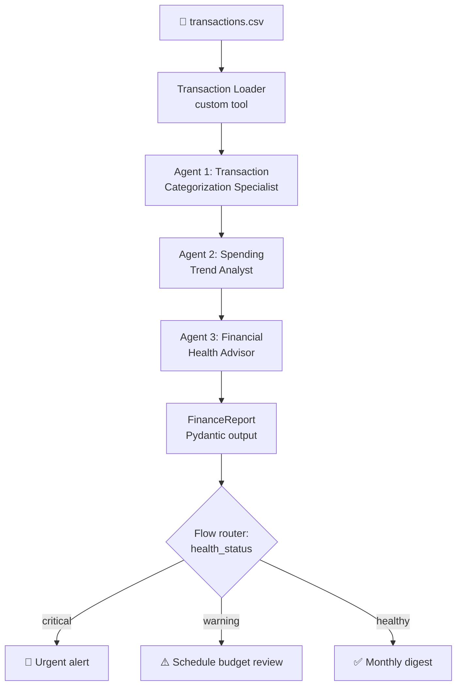

# 💰 Personal Finance Health Checker

**A multi-agent AI system that analyzes your spending and tells you if your finances are healthy, need attention, or are in trouble.**

Give it a CSV of your transactions. Three AI agents categorize the spending, find the fastest-growing costs, and write a structured financial health report. A CrewAI Flow then reads the result and routes it to the right next action.

Built to apply what I learned in DeepLearning.AI's *Practical Multi AI Agents and Advanced Use Cases with crewAI* course.

---

## How it works



| Agent | Job |
|---|---|
| **Transaction Categorization Specialist** | Uses the custom tool to load the CSV and report monthly totals per category |
| **Spending Trend Analyst** | Finds the categories rising and falling fastest and explains why |
| **Personal Financial Health Advisor** | Assigns a health status and writes 2–4 specific recommendations |

---

## What it demonstrates

- **YAML-based configuration:** agents and tasks are defined in `config/agents.yaml` and `config/tasks.yaml`, separate from the code.
- **Custom tool:** `TransactionLoaderTool` (built on CrewAI's `BaseTool`) reads the CSV with pandas, groups spend by month and category, and computes percent changes, so agents work from exact numbers instead of guessing.
- **Structured output:** the final task returns a validated Pydantic `FinanceReport` (summary, top overspend category, health status, recommendations).
- **CrewAI Flow with a router:** `@start`, `@listen` and `@router` decorators branch the workflow into three different actions based on the report.
- **Testing and training:** uses CrewAI's built-in `crew.test()` to score output quality and `crew.train()` to improve the agents with feedback.
- **Groq LLM:** runs on `openai/gpt-oss-120b` through Groq's OpenAI-compatible API.

---

## Example output

From the sample data in `data/transactions.csv` (April to June 2026):

```text
health_status:          critical
top_overspend_category: Dining
summary: Your spending jumped 41% from April to June, driven by sharp rises in
         Dining, Shopping, and Entertainment.
recommendations:
  - Cap Dining out to a maximum of $200 per month and track each meal
  - Trim Shopping spend by at least 50%: set a $150 monthly limit
  - Cut Entertainment expenses in half by choosing free or low-cost activities
```

LLM output varies between runs, so the same data can occasionally be rated `warning` instead of `critical`. The Flow handles each case.

---

## Project structure

```
personal-finance-health-checker/
├── Personal_Finance_Health_Checker.ipynb   # Main notebook (Google Colab)
├── config/
│   ├── agents.yaml                         # Agent roles, goals, backstories
│   └── tasks.yaml                          # Task descriptions and expected outputs
├── data/
│   └── transactions.csv                    # Sample transactions (3 months)
└── requirements.txt
```

## Getting started

The project runs in **Google Colab**.

1. Open `Personal_Finance_Health_Checker.ipynb` in Colab.
2. Add your Groq API key under **Secrets** (🔑 in the left sidebar) as `GROQ_API_KEY`.
3. Run the cells in order. When the upload prompt appears, upload `config/agents.yaml`, `config/tasks.yaml` and `data/transactions.csv`.
4. The notebook runs the crew, the test and train steps, and finally the Flow.

To use your own data, upload a CSV with these columns: `date`, `category`, `description`, `amount`.

## Tech stack

Python · CrewAI (Agents, Tasks, Flows) · Groq API · Pydantic · pandas · PyYAML · Google Colab

---

## Author

**Ala Al-Duais** · [GitHub](https://github.com/ala-alduais)
